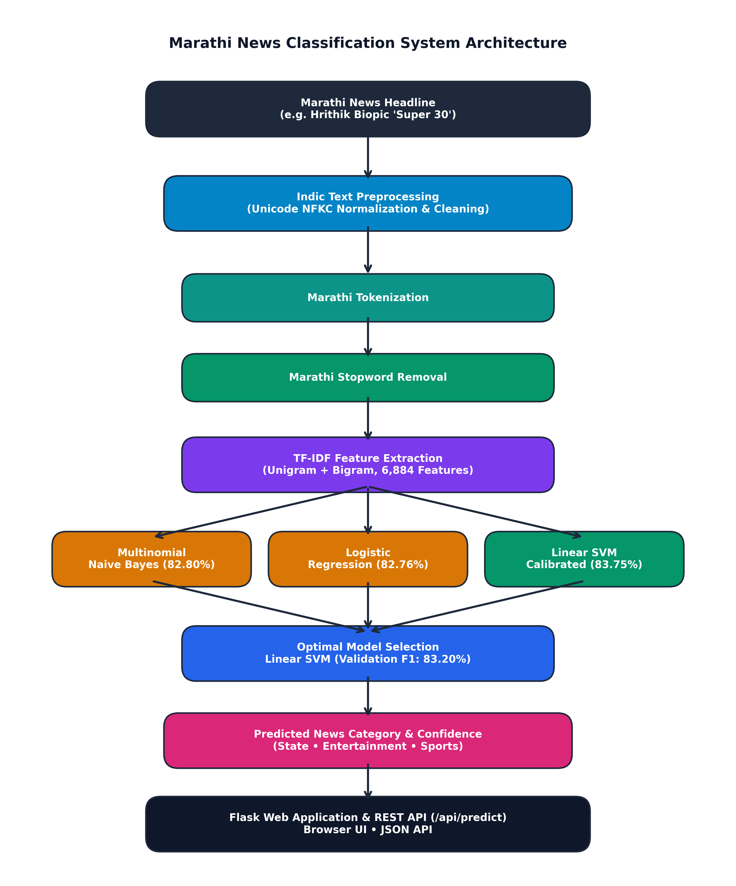

# Marathi News Classification Using Natural Language Processing

An end-to-end Machine Learning and Indic Natural Language Processing (NLP) system designed to automatically classify Marathi news headlines into 3 distinct categories: **State (राज्य)**, **Entertainment (मनोरंजन)**, and **Sports (क्रीडा)**.



---

## 📌 Project Abstract
With the rapid digitization of regional Indian language media, vernacular news platforms generate thousands of Marathi news headlines every day. Manual sorting, routing, and categorization is labor-intensive and unsustainable. This project presents an end-to-end computational pipeline that ingests Marathi text written in Devanagari script, applies Unicode NFKC normalization, text cleaning, tokenization, and Devanagari stopword removal, transforms text into sublinear n-gram TF-IDF representations, and classifies them across 3 distinct categories using machine learning classifiers. The dataset is provided as separate training (`data/train.csv` with 9,673 samples) and validation (`data/valid.csv` with 2,419 samples) files. On an empirical benchmark comparing Multinomial Naive Bayes, Logistic Regression, and Linear Support Vector Machines (SVM) evaluated strictly on the unseen validation dataset, the calibrated Linear SVM achieved the best validation accuracy of **83.75%** and Weighted F1-score of **83.20%**.

---

## 🎯 Problem Statement & Objectives
### Problem Statement
Most state-of-the-art NLP tools are heavily tailored for English and morphologically simple languages. Marathi is an Indo-Aryan language characterized by agglutinative morphology, rich inflectional forms, and Devanagari Unicode nuances. Developing an automated, real-time classifier that accurately predicts news domains without lossy transliteration is crucial for vernacular information retrieval.

### Project Objectives
1. **Devanagari Script Preservation:** Clean and normalize Marathi text without transliterating into Latin characters.
2. **Robust Indic Preprocessing:** Filter grammatical Marathi particles and stopwords while retaining semantic domain indicators.
3. **Multi-Model Benchmark:** Train, evaluate, and contrast three candidate classifiers (Multinomial Naive Bayes, Logistic Regression, Linear SVM) on the separate validation dataset (`data/valid.csv`).
4. **Calibrated Confidence Estimation:** Provide authentic mathematical probability scores for predictions.
5. **Interactive Web Application & REST API:** Deploy a production-ready Flask web platform and JSON API.

---

## 🛠️ Technology Stack
* **Language:** Python 3.12+
* **Backend Framework:** Flask 3.1+
* **Machine Learning & NLP:** Scikit-learn, Pandas, NumPy, Joblib
* **Data Visualization:** Matplotlib, Seaborn
* **Frontend:** HTML5, CSS3, JavaScript, Bootstrap 5
* **Typography:** Google Fonts (Mukta, Noto Sans Devanagari, Poppins)

---

## 📂 Project Structure
```text
marathi-news-classification/
│
├── app.py                      # Flask Web Application & REST API entry point
├── requirements.txt            # Project dependencies
├── README.md                   # Comprehensive project documentation
├── PROJECT_REPORT.md           # Academic Project Report
├── .gitignore                  # Git ignore rules
│
├── data/
│   ├── train.csv               # Official training dataset (9,673 samples)
│   ├── valid.csv               # Official validation dataset (2,419 samples)
│   └── marathi_news.csv        # Backup dataset
│
├── models/
│   ├── tfidf_vectorizer.pkl    # Trained TF-IDF Vectorizer (6,884 features)
│   ├── news_classifier.pkl     # Best trained classifier (Calibrated Linear SVM)
│   └── model_metadata.json     # Hyperparameters, metrics, and class metadata
│
├── src/
│   ├── __init__.py             # Package initializer
│   ├── preprocessing.py        # Reusable Devanagari normalization & stopword removal
│   ├── generate_dataset.py     # Dataset utilities
│   ├── train_model.py          # Complete training, evaluation & artifact export pipeline
│   ├── predict.py              # CLI and programmatic inference engine
│   ├── evaluate.py             # Metrics computation and visualization generator
│   └── generate_diagram.py     # Architecture diagram generator
│
├── templates/
│   ├── base.html               # Base layout with responsive navigation & styling
│   ├── index.html              # Home page with prediction form and result card
│   ├── about.html              # Project concepts and Indic NLP overview
│   ├── model.html              # Detailed methodology and ML pipeline
│   └── results.html            # Dynamic metrics, comparison table, and charts
│
├── static/
│   ├── css/
│   │   └── style.css           # Custom styles, vibrant badges, and responsive UI
│   ├── js/
│   │   └── script.js           # Client-side validation and UX interaction
│   └── images/
│       ├── category_distribution.png
│       ├── confusion_matrix.png
│       ├── model_comparison.png
│       └── architecture_diagram.png
│
├── results/
│   ├── category_distribution.png
│   ├── confusion_matrix.png
│   ├── model_comparison.png
│   ├── architecture_diagram.png
│   ├── architecture_diagram.txt
│   └── metrics.json
│
└── tests/
    ├── test_predictions.py     # 3-category verification & edge-case test suite
    └── test_web_api.py         # Automated Flask web routes and API tests
```

---

## 🏷️ News Categories (3 Classes)
The system categorizes news headlines into 3 classes:
1. **State (राज्य)**: Regional governance, state politics, civic issues, district administration, infrastructure, and local events.
2. **Entertainment (मनोरंजन)**: Cinema, Bollywood, Marathi theatre, television, OTT series, and celebrity news.
3. **Sports (क्रीडा)**: Cricket tournaments, championships, athletics, kabaddi, and national/international sports.

---

## 📊 Dataset Details
* **Dataset Files:** Provided as separate training (`data/train.csv`) and validation (`data/valid.csv`) files.
* **Training Set:** 9,673 records
  * `State`: 6,035 samples (62.39%)
  * `Entertainment`: 2,644 samples (27.33%)
  * `Sports`: 994 samples (10.28%)
* **Validation Set:** 2,419 records
  * `State`: 1,512 samples (62.51%)
  * `Entertainment`: 679 samples (28.07%)
  * `Sports`: 228 samples (9.43%)
* **Total Dataset Size:** 12,092 records
* **Format:** CSV (`headline,label`) with UTF-8 encoding.
* **Integrity:** Zero null values, no overlapping partitions, clean Devanagari text.

---

## 🔬 NLP Preprocessing Pipeline
The same modular pipeline is used in both training and prediction to eliminate feature drift:
1. **Unicode NFKC Normalization:** Standardizes combined graphemes and vowel diacritics.
2. **Noise Cleaning:** Strips URLs (`https?://...`), HTML elements, and punctuation marks (`।`, `॥`, quotes, symbols).
3. **Devanagari Preservation:** Retains Marathi characters (`\u0900-\u097F`) and alphanumeric indicators.
4. **Tokenization:** Splits cleaned Marathi text into word tokens.
5. **Devanagari Stopword Removal:** Filters high-frequency functional particles (`आणि`, `व`, `आहेत`, `झाले`, `त्यांनी`, `म्हणून`).
6. **Whitespace Normalization:** Strips redundant spaces into clean single-spaced strings.

---

## 📈 Empirical Results & Model Comparison
Models were trained on `data/train.csv` (9,673 samples) and evaluated strictly on the unseen `data/valid.csv` (2,419 samples).

### Comparative Performance Table
| Model | Validation Accuracy | Weighted Precision | Weighted Recall | Weighted F1 Score | Macro F1 Score |
| :--- | :---: | :---: | :---: | :---: | :---: |
| **Multinomial Naive Bayes** | 82.80% | 82.77% | 82.80% | 81.97% | 76.03% |
| **Logistic Regression** | 82.76% | 82.80% | 82.76% | 81.92% | 75.36% |
| **Linear SVM (Calibrated)** | **83.75%** | **83.54%** | **83.75%** | **83.20%** | **77.74%** |

### Selected Model
* **Algorithm:** Calibrated Linear Support Vector Machine (`CalibratedClassifierCV(LinearSVC)`)
* **Validation Accuracy:** **83.75%**
* **Weighted F1 Score:** **83.20%**
* **Confidence Method:** Platt Sigmoid Calibration (authentic posterior class probabilities)

---

## 🚀 Setup & Execution Guide

### 1. Prerequisites
Ensure Python 3.10+ is installed on your system.

### 2. Install Dependencies
```bash
pip install -r requirements.txt
```

### 3. Train the Model & Generate Artifacts
```bash
python src/train_model.py
```

### 4. Run the CLI Prediction Engine
```bash
python src/predict.py
```
Or predict a single headline directly:
```bash
python src/predict.py "हृतिक करतोय बायोपिक 'सुपर 30'"
```

### 5. Launch the Web Application
```bash
python app.py
```
Open your browser and navigate to:
```text
http://127.0.0.1:5000
```

---

## 🌐 REST API Documentation

### 1. Predict Category
* **Endpoint:** `POST /api/predict`
* **Headers:** `Content-Type: application/json`
* **Request Body:**
```json
{
  "headline": "हृतिक करतोय बायोपिक 'सुपर 30'"
}
```
* **Success Response (200 OK):**
```json
{
  "category": "Entertainment",
  "confidence": 0.5165,
  "confidence_percent": "51.65%",
  "confidence_type": "Calibrated Probability",
  "headline": "हृतिक करतोय बायोपिक 'सुपर 30'",
  "probabilities": {
    "Entertainment": 0.5165,
    "State": 0.4442,
    "Sports": 0.0393
  }
}
```

### 2. Health Check
* **Endpoint:** `GET /api/health`
* **Response (200 OK):**
```json
{
  "model_loaded": true,
  "status": "healthy"
}
```

### 3. Error Responses
* **400 Bad Request:** Missing payload, non-JSON body, or empty headline.
* **400 Bad Request:** Non-Devanagari text entered (e.g. English-only).

---

## 🧪 Automated Testing
Run the test suites to verify functionality:
```bash
# Test 3 categories and edge cases
python tests/test_predictions.py

# Test web routes, API endpoints, and static assets
python tests/test_web_api.py
```
